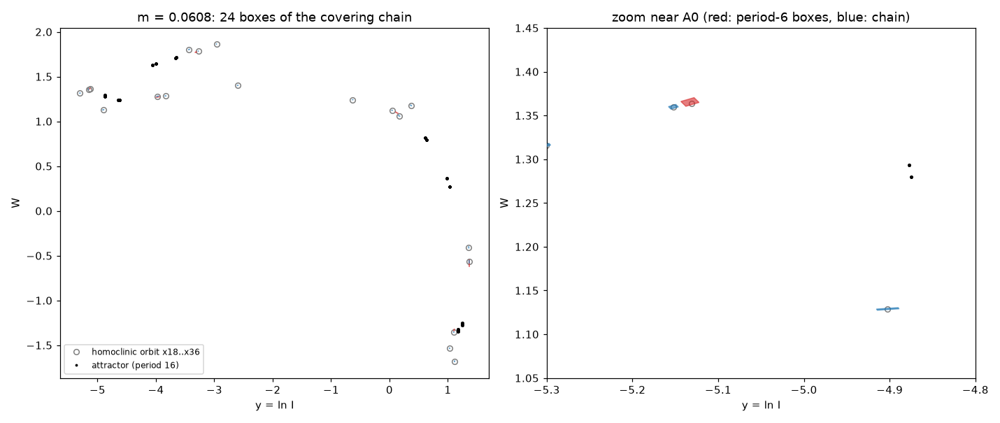

# A chaotic invariant set in the loss-modulated class-B laser: a computer-assisted proof

**Moki & Julio · 2026** · DOI [10.5281/zenodo.23422903](https://doi.org/10.5281/zenodo.23422903) (v1.0)

## In plain words

In 1982 a group in Florence drove a CO2 laser into chaos by periodically modulating its cavity losses [2]. Lasers of
this kind (class-B lasers) are described by two rate equations, one for the light intensity and one for the population
inversion. A 2025 review by Oppo [1] writes them, with the loss modulation, as its Eq. (27), and studies them by
simulation.

As far as we could find, nobody has proved that these equations have chaotic dynamics. This repository proves it at the
review's own parameters. Inside the laser's state space there is a set of motions that is provably chaotic: it carries
infinitely many periodic orbits and positive topological entropy. The proof is computer-assisted. Every rounding error
is bounded with interval arithmetic, and two independently written programs check it.

The chaos we prove is partly hidden. In our long, high-accuracy simulations at these parameters, the laser does not keep
wandering chaotically. It settles onto a regular rhythm that repeats every 16 modulation periods. The proved chaotic set coexists with that
rhythm. The period-16 rhythm is a numerical observation; we do not prove it.



## The equations

Oppo's Eq. (27) [1], verbatim:

```
dI/dτ = I (W + (m/ε) cos(ωt))
dW/dτ = μ − (1 + εW)(1 + I)
```

The line below the equation in [1] says that ω is "normalized to τ" (τ = √(2kγ∥) t). We therefore read the forcing as
cos(ωτ), with τ the normalised time throughout. This reading reproduces the paper's Fig. 14(c) and (d) (see the model
check below).

- I ≥ 0 is the laser intensity, and W is the scaled deviation of the population inversion from its steady value.
- ε = √(γ∥/2k), where γ∥ is the decay rate of the population inversion and k is the cavity loss rate.
- μ is the pump.
- m and ω are the modulation depth and frequency.

The parameters are those of [1], Fig. 15(a):

```
μ = 2,   ε = 0.04,   ω = 1.1,   m = 0.0608
```

In the proof these are the exact rationals 2, 1/25, 11/10 and 76/1250.

We work in log-intensity y = ln I. The half-plane I > 0 is invariant, so this is an exact change of variables there:

```
dy/dτ = W + (m/ε) cos(ωτ)
dW/dτ = μ − (1 + εW)(1 + e^y)
```

P denotes the stroboscopic map. P(y, W) is the state after one modulation period T = 2π/ω of the solution that starts
at (y, W) at phase τ = 0.

- **Phase convention.** Starting at another phase, or writing −cos for cos, gives a conjugate map. The theorem does not
  depend on that choice; only the coordinates of the boxes do.
- **Model check.** Our integration reproduces the shapes of the period-2 and period-4 orbits in [1], Fig. 14(c) and
  (d) (`figures/model_check_fig14.png`, `design/figs.txt`). At the parameters of Fig. 14(a) and (b), our default
  starting point lands on a coexisting larger period-3 orbit instead. We did not search there for the paper's
  period-1 and period-2 orbits.

## Theorem

There are 24 pairwise disjoint h-sets in the (y, W) plane: A0, …, A5 and C18, …, C35. Their exact definitions are in
[`proof/design_chain.txt`](proof/design_chain.txt): each is a box in its own affine chart, with an exit (stretching)
direction and an entry (contracting) direction. P satisfies the 25 covering relations

```
A0 ⇒ A1 ⇒ A2 ⇒ A3 ⇒ A4 ⇒ A5 ⇒ A0,
A5 ⇒ C18 ⇒ C19 ⇒ … ⇒ C35 ⇒ A0.
```

A covering relation N ⇒ M means that P stretches N across M, in the topological sense of Zgliczyński and Gidea [4].
Let G be the directed graph above. Its two simple loops through A0 have lengths 6 and 24. Consequently:

1. **Any itinerary is realised.** Write a motion as a sequence of two kinds of block:
   - **S:** six periods round the A-cycle;
   - **L:** 24 periods: the five steps A0 → … → A5, then the 19-period excursion A5 → C18 → … → C35 → A0.

   For every infinite sequence of S and L blocks, in any order, there is an exact solution that follows it.
2. **Infinitely many periodic orbits.** Every periodic such sequence is realised by a periodic orbit of P. Their
   periods are multiples of 6.
3. **Positive entropy.** Let Λ be the set of points x whose two-sided P-orbit visits the h-sets along the edges of G:
   P^k(x) lies in an h-set N_k for every integer k, and each N_k ⇒ N_(k+1) is an edge of G.
   - Every bi-infinite path of G is realised by a point of Λ ([4], Thm 9 and Cor. 12, with compactness).
   - Because the h-sets are disjoint, the path is determined by the point.
   - So Λ is compact and invariant, and P on Λ is semi-conjugate (onto) to the subshift of finite type of G.

   Hence
   - h_top(P) ≥ h_top(P|Λ) ≥ ln r ≈ **0.0537 per modulation period**, where r ≈ 1.05518 is the largest root of
     x²⁴ = x¹⁸ + 1;
   - equivalently, h_top(P⁶|Λ) ≥ 6 ln r ≈ 0.322;
   - on the part of Λ that lies in A0 at every multiple of 24 periods, P²⁴ is semi-conjugate to the full shift on two symbols
     (four short loops, or the long loop): a horseshoe for P²⁴.

**What is not claimed:**
- that the long-run behaviour at these parameters is chaotic (numerically it is a period-16 cycle; see below);
- that Λ is hyperbolic or non-attracting;
- anything about Lyapunov exponents or "almost every orbit";
- the existence of the numerical saddle orbit and homoclinic orbit that guided the design. The theorem only gives a
  periodic orbit inside the A-boxes, with itinerary SSS…;
- anything at other parameter values.

## Numerical note: the long-run motion at these parameters (not proved)

Our high-accuracy simulations at the paper's parameters converge to a stable period-16 cycle. This does not affect the
theorem, which concerns a chaotic invariant set, not the attractor. The caption of [1], Fig. 15(a) describes the motion
at these parameters as asymptotically chaotic. We do not know how that figure was computed.

- **Method.** DOP853 with relative and absolute tolerance 1e-12, in the (y, W) variables. We discarded 250-500 transient
  periods. All 25 starting points we tried reached the same attractor. Their finite-time (150-period) Lyapunov
  estimates are all negative, from −0.047 to −0.0001 per period (`design/scan.txt`).
- **Lyapunov sweep.** We swept m from 0.0590 to 0.0658 in steps of 0.0004. The largest Lyapunov exponent is negative
  up to m = 0.0606 and positive from m = 0.0610, apart from one periodic window at m = 0.0638
  (`design/sweep.txt`). Attracting chaos therefore starts just above the
  paper's value.
- **The cycle is stable.** Newton's method on P¹⁶ converges to the cycle. The multipliers of P¹⁶ are 0.63977 and
  0.00102, both inside the unit circle (`design/period16.txt`).
- **Independent checks.** Two separate review seats integrated the original (I, W) variables with their own code and
  found period 16 every time.
  - Integrators: RK45, DOP853, LSODA and Radau.
  - Tolerances: relative 1e-6 to 1e-13.
  - Transients: up to 5000 periods.
  - Starting points spread over the region of Fig. 15(a).
  - One seat obtained the same multipliers to eight decimal places.
  - Outputs: `checks/blind_seat/floquet.txt`, `checks/blind_seat/longrun.txt` and `checks/referee_seat/per16_out.txt`.
- **Size of the cycle.** The continuous period-16 orbit spans I up to 5.08 and W from −2.82 to 2.48, close to the extent
  of the band drawn in [1], Fig. 15(a).
- **Loose tolerances (post hoc).** At relative tolerance 1e-3 (RK45), no return within 1e-6 is found up to 64 periods.
  But the closest returns (2e-3 to 6e-3) fall at multiples of 16 (`checks/referee_seat/per16_out.txt`). The run stays
  close to the cycle; loose tolerance alone does not produce irregular motion.

Numerically, the proved chaotic set coexists with this stable cycle; that it is non-attracting is not part of the
theorem. The paper's value m = 0.0608
lies in the last steps of the period-doubling cascade, just before attracting chaos sets in.

## How the proof was built and checked

**1. Guide (numerical, not part of the proof).**
- **The saddle orbit.** P has a period-6 saddle orbit through (y, W) ≈ (−5.13286, 1.36542), where I ≈ 0.0059. Its
  multipliers over six periods are about 9.072 and 0.00704.
- **The homoclinic orbit.** Shooting along its unstable direction gives an orbit that leaves the saddle orbit, makes one
  large excursion over modulation periods 24-31, and returns along the stable direction: a numerical homoclinic orbit.

**2. 24 thin boxes.**
- A0 to A5 sit on the saddle orbit.
- C18 to C35 sit on the homoclinic orbit from period 18 to period 35.
- Each box is aligned with the local stretching direction (pushed forward along the orbit) and the local contracting
  direction (pulled back).
- The box sizes follow the stretching factors, with a safety margin per period. Every link is one modulation period.

**3. Each covering relation N ⇒ M is three inequalities,** for one application of P:
- **(E−)** P maps the left exit edge of N strictly beyond one side of M;
- **(E+)** P maps the right exit edge strictly beyond the other side;
- **(S)** the whole image of N stays strictly inside M's band in the contracting direction.

Together with the disjointness of the 24 boxes, these are the hypotheses of the covering-relation theorem.

**4. Rigorous arithmetic.** Every inequality is checked with interval arithmetic and validated Taylor integration of the
ODE, using the CAPD library [5]. Every edge and box is covered by small pieces, and each piece's image is enclosed with
guaranteed error bounds. Pieces whose enclosure is not decisive are split until it is.

**The charts.** An affine chart X = Q + uU + sS with det[U S] ≠ 0 is a homeomorphism of the plane. The choice of
charts, box sizes and splitting can therefore only make a check fail, never pass falsely.

## Results

Two independent programs were run on the same design file.

**Checker A** ([`proof/check_laser.cpp`](proof/check_laser.cpp)):
- Writes the modulation as a rotating pair (c, s) = (cos ωτ, sin ωτ), which makes the system autonomous. Uses CAPD's
  Lohner "tripleton" sets.
- Is the checker of our earlier proof for Ueda's oscillator [6] with the vector field, the parameters, the
  negative-control switch and a non-rigorous early-exit test replaced. The early-exit test can only make it reject.
- 5,736 enclosures and 276 disjointness tests, **23 s** on one core: **VERIFIED.** Timings: `proof/logs/run_all_recorded.log`.
- Also VERIFIED at Taylor orders 10 (52 s) and 14 (27 s).

**Checker B** ([`independent/`](independent/)):
- Written independently, from the specification [`independent/SPEC.md`](independent/SPEC.md) only, without access to
  checker A.
- Carries time as an explicit variable, uses CAPD's "doubleton" sets, inverts charts by the adjugate formula, and proves
  disjointness with separating axes.
- 5,200 integrations, **36 s**: **VERIFIED.** Also VERIFIED at Taylor order 14 on a finer grid.
- Report: [`independent/REPORT_B.md`](independent/REPORT_B.md).

Both checkers use CAPD's interval arithmetic and its ODE solver, so a bug in CAPD itself would affect both. The negative
and positive controls guard against that only partly.

Smallest proven margin per link (checker B, in the target box's chart units; all strictly positive):

| link | exit, left edge (E−) | exit, right edge (E+) | band (S) |
|---|---|---|---|
| A0 ⇒ A1 | 1.33e-03 | 1.25e-03 | 1.87e-03 |
| A1 ⇒ A2 | 1.78e-03 | 1.95e-03 | 2.44e-03 |
| A2 ⇒ A3 | 3.71e-03 | 2.72e-03 | 9.60e-04 |
| A3 ⇒ A4 | 4.00e-03 | 4.55e-03 | 6.07e-04 |
| A4 ⇒ A5 | 3.55e-03 | 5.98e-03 | 2.52e-03 |
| A5 ⇒ A0 | 2.84e-02 | 2.72e-02 | 2.87e-03 |
| A5 ⇒ C18 | 1.18e-02 | 5.07e-02 | 8.93e-04 |
| C18 ⇒ C19 | 1.61e-03 | 1.59e-03 | 2.05e-03 |
| C19 ⇒ C20 | 1.89e-03 | 1.94e-03 | 1.38e-03 |
| C20 ⇒ C21 | 2.82e-03 | 2.69e-03 | 1.11e-03 |
| C21 ⇒ C22 | 3.10e-03 | 3.15e-03 | 4.42e-04 |
| C22 ⇒ C23 | 2.95e-03 | 3.21e-03 | 1.91e-03 |
| C23 ⇒ C24 | 1.98e-03 | 1.89e-03 | 6.92e-04 |
| C24 ⇒ C25 | 1.78e-03 | 1.75e-03 | 1.39e-03 |
| C25 ⇒ C26 | 1.97e-03 | 2.01e-03 | 9.38e-04 |
| C26 ⇒ C27 | 3.30e-03 | 3.21e-03 | 6.68e-04 |
| C27 ⇒ C28 | 4.58e-03 | 4.64e-03 | 5.99e-04 |
| C28 ⇒ C29 | 5.87e-03 | 5.11e-03 | 4.14e-04 |
| C29 ⇒ C30 | 4.92e-03 | 5.18e-03 | 5.88e-04 |
| C30 ⇒ C31 | 2.99e-03 | 3.04e-03 | 1.23e-03 |
| C31 ⇒ C32 | 4.56e-03 | 4.44e-03 | 8.89e-04 |
| C32 ⇒ C33 | 5.71e-03 | 6.47e-03 | 6.36e-04 |
| C33 ⇒ C34 | 6.45e-03 | 6.18e-03 | 7.29e-04 |
| C34 ⇒ C35 | 6.14e-03 | 5.42e-03 | 2.09e-03 |
| C35 ⇒ A0 | 7.79e-03 | 8.06e-03 | 7.36e-04 |

**Controls,** all run by `reproduce.sh`:
- **Library semantics.** CAPD's interval comparisons mean *certainly* (`proof/controls/cmp_test.cpp`).
- **A known result.** CAPD's bundled Rössler horseshoe example runs and every line reads true.
- **Checker A rejects all six negative controls:**
  - the last link with its orientation flipped;
  - A0 too thin to receive C35's image;
  - C27 three times too wide to be crossed;
  - C25 moved five half-widths off the orbit;
  - C18 placed on top of A0 (disjointness must fail);
  - m changed to 0.0590.
- **A non-rigorous cross-check by a blind seat.** A separate seat sampled every one of the 25 links on a 301 × 301 grid
  in the original (I, W) variables, about 2.3 million points, and found no violation. The worst margin was 0.108 of the
  target half-width (`checks/blind_seat/cover_dense.txt`). It also found all 24 boxes disjoint
  (`checks/blind_seat/disjoint.txt`).
- **Rigorous path alone.** The referee seat rebuilt checker A with its non-rigorous early-exit test switched off. The
  rigorous path alone still rejects four of the altered designs: the flipped orientation, the too-thin A0, the
  too-wide C27 and the shifted C25 (`proof/controls/no_helper/`).
- **Checker B rejects its three negative controls:** the flipped last link, m = 0.0590, and the too-thin A0.

**Pre-registration.** The pass criteria, controls and file hashes were written down and hashed before the recorded
runs. One earlier coarse trial run (4 pieces instead of 64) had already passed on this design, and that was recorded
too.

## Reproduce

Requires Linux (or WSL), g++ ≥ 11, CMake and git.

```
bash reproduce.sh
```

What it does:
- builds CAPD 6.1 at the pinned commit `03dc5628203334b214bb7d9fd63788a175521005`;
- prints the SHA-256 of the proof inputs;
- compiles both checkers;
- runs every proof and every control.

It exits with status 0, printing `REPRODUCE: ALL RESULTS AND CONTROLS AS STATED`, only if every proof verifies and
every negative control is rejected. [`reproduce_full.log`](reproduce_full.log) is the complete output of our own
clean-room run (a fresh copy and a fresh CAPD clone).

[`design/`](design/) holds the non-rigorous Python scripts. None of them is needed to check the proof. Run them from
inside `design/`:

| Script | What it does |
|---|---|
| `lasermap.py` | the map |
| `figs.py` | the Fig. 14 model check |
| `attractor.py` | the attractor and its Lyapunov exponent |
| `scan.py` | 25 starting points |
| `period16.py` | the period-16 cycle and its multipliers |
| `sweep.py` | the Lyapunov sweep in m |
| `porbits.py` | periodic orbits |
| `orb6.py` | the period-6 saddle and its stretching factors |
| `manif2.py`, `cross.py` | manifolds and their crossings |
| `shoot.py`, `homo.py`, `homo_print.py` | the homoclinic orbit (`homo.txt`) |
| `fig_proof.py` | the figure |

`design.py` rebuilds `proof/design_chain.txt` byte for byte with
`python design.py out.txt 1.4 2.0 0.008 1.15 2.0`.

## Prior work we checked

Searches on 2026-10-16 covered:
- arXiv and Zenodo (keyword searches);
- the web;
- every work that cites the 1982 Florence experiment [2], the Physica D paper [3] or the review [1] (OpenAlex
  citation lists, about 600 papers).

The search terms combined laser, class B, CO2, modulated losses, rate equations and Toda oscillator with rigorous,
computer-assisted, interval arithmetic, covering relations, horseshoe, Conley index, symbolic dynamics, topological
entropy and Melnikov.

What turned up:
- **Simulations.** Many numerical and experimental studies of chaos in loss-modulated lasers, starting with [2].
- **Analytic work.** The nearest is Carr, Billings, Schwartz and Triandaf [3]. For driven class-B lasers they describe,
  with matched asymptotics and *subharmonic* Melnikov theory, the heteroclinic connections that give rise to chaotic
  saddles. They note (p. 60) that the classical Melnikov method does not apply to these equations, because the needed
  symmetry is absent. Their work locates the organising orbits; it is not a horseshoe or entropy theorem at given
  parameters.
- **Rigorous proofs.** We found no rigorous or computer-assisted chaos proof for class-B rate equations with modulated
  losses, at any parameters.

If we have missed a rigorous result for this model, we will credit it here.

## References

1. G.-L. Oppo, "Computational Physics Applied to Photonic Devices", arXiv:2510.18472 (2025). Sect. 3.2, Eq. (27), p. 27; Figs. 14 (p. 27) and 15 (p. 28).
2. F. T. Arecchi, R. Meucci, G. P. Puccioni, J. R. Tredicce, "Experimental Evidence of Subharmonic Bifurcations, Multistability, and Turbulence in a Q-Switched Gas Laser", *Phys. Rev. Lett.* 49 (1982) 1217, doi:10.1103/PhysRevLett.49.1217. Described here as in [1], p. 27.
3. T. W. Carr, L. Billings, I. B. Schwartz, I. Triandaf, "Bi-instability and the global role of unstable resonant orbits in a driven laser", *Physica D* 147 (2000) 59-82, doi:10.1016/S0167-2789(00)00164-0.
4. P. Zgliczyński, M. Gidea, "Covering relations for multidimensional dynamical systems", *J. Differential Equations* 202 (2004) 32-58, doi:10.1016/j.jde.2004.03.013.
5. T. Kapela, M. Mrozek, D. Wilczak, P. Zgliczyński, "CAPD::DynSys: a flexible C++ toolbox for rigorous numerical analysis of dynamical systems", *Commun. Nonlinear Sci. Numer. Simul.* 101 (2021) 105578, doi:10.1016/j.cnsns.2020.105578 (arXiv:2010.07097).
6. Moki & Julio, "Ueda's oscillator is chaotic: a computer-assisted proof" (2026), doi:10.5281/zenodo.23172757.

## Licence and citation

- **Licences:** text, figures and data are CC BY 4.0 (`LICENSE`); code is MIT (`LICENSE-CODE`). CAPD is used under its
  own licence and is not redistributed.
- **Authorship:** built with AI assistance.
- **Citation:** see `CITATION.cff`.
