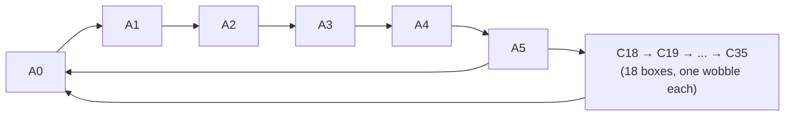
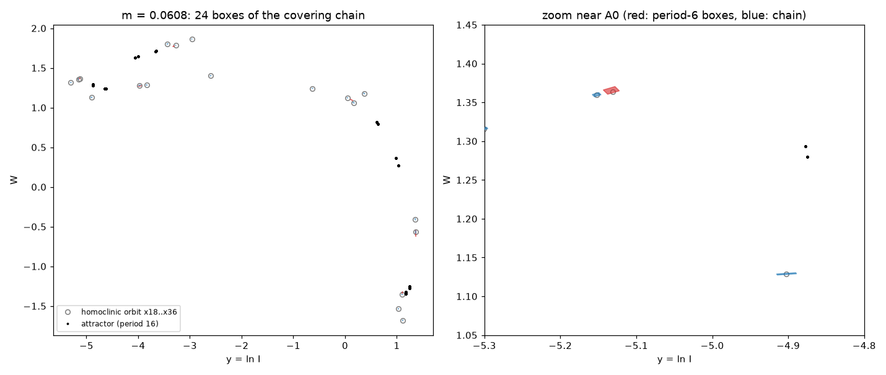

# A chaotic invariant set in the loss-modulated class-B laser: a computer-assisted proof

**A laser whose losses are wobbled was driven into chaos in a 1982 experiment, and its standard equations have been
studied by simulation. We proved those equations contain chaotic motions at a 2025 review's own settings. Yet
in our long simulations at those same settings the laser settles into a rhythm that repeats every 16 wobbles: the chaos
is real, but hidden.** (The 16-wobble rhythm is a numerical observation; we do not prove it.)

Moki & Julio · 2026 · DOI [10.5281/zenodo.23422903](https://doi.org/10.5281/zenodo.23422903) (v1.0) ·
text CC BY 4.0, code MIT

## The story in a minute

In 1982 a group in Florence drove a CO2 laser into chaos by periodically modulating its cavity losses: wobbling how much
light leaks out of it. Lasers of this kind (class-B lasers) are described by two equations, one for the light intensity
and one for the population inversion (the stock of excited molecules ready to emit). A 2025 review by Oppo writes them,
with the wobble, as its Eq. (27), and studies them by simulation.

As far as we could find, nobody had proved that these equations have chaotic dynamics. This repository proves it at the
review's own parameters. Inside the laser's possible states there is a set of motions that is provably chaotic: it
carries infinitely many periodic orbits and positive topological entropy.

A picture that helps: **kneading dough.** A baker stretches the dough long, lays it back across itself and stretches
it again. Crumbs that start side by side can be sent along completely different routes. Here the "dough" is the set of possible laser states (intensity and
inversion), and one wobble of the losses moves it. We picked 24 small, thin boxes of states along two numerically found
routes, and proved that one wobble stretches each box right across the next one, overhanging both ends.

Where the picture breaks, and why it matters here: a baker mixes all the dough. In this laser, our long, high-accuracy
simulations show nearly the opposite: every starting point we tried settles onto a regular rhythm that repeats every 16
wobbles. The proved chaotic set coexists with that rhythm. So the chaos is real but hidden: what a long simulation
shows is the rhythm, and here most nearby states actually draw together. That rhythm is a numerical result, not part
of the theorem. The theorem says nothing about how fast nearby states separate (no Lyapunov exponents).

"Proved" here means this. Every calculation returns a range that is guaranteed to contain the true value, with every
rounding error counted. Two programs, written separately, check the whole chain. Both say VERIFIED, and both reject
deliberately broken versions of the boxes.

## Climb the ladder

### Step 1 - the idea (for anyone)

Look at the laser once per wobble, like a strobe light that flashes once per modulation period. Each flash shows a
point in a plane: log-intensity across, inversion up. The rule that takes one flash to the next is the
**stroboscopic map** P.

The route map has a six-box loop A0 to A5, which sits on a numerically found six-period cycle, and an 18-box excursion
C18 to C35, which follows a numerically found orbit that leaves that cycle and comes back.



Write any motion as a string of two blocks: **S**, six wobbles round the A-loop, and **L**, 24 wobbles (A0 to A5, then
the 19-wobble excursion back to A0). The theorem: for **every** endless string of S and L blocks, in any order, there
is an exact solution of the equations that follows it.

### Step 2 - how it works (for a curious student)

The equations, in log-intensity y = ln I and inversion W, are

```
dy/dτ = W + (m/ε) cos(ωτ)
dW/dτ = μ − (1 + εW)(1 + e^y)
```

with the review's values μ = 2 (the pump), ε = 0.04 (a small number set by how fast the inversion decays compared
with how fast light leaks out), ω = 1.1 (the wobble frequency) and m = 0.0608 (the wobble depth). The proof uses them
as the exact fractions 2, 1/25, 11/10 and 76/1250.

**Finding the boxes (not part of the proof).** Simulations show a six-period saddle orbit through (y, W) ≈ (−5.13286,
1.36542), where I ≈ 0.0059. Over six wobbles it stretches nearby states by about 9.072 in one direction and squeezes
them by about 0.00704 in the other. Shooting out along the stretching direction gives an orbit that makes one large
excursion over wobbles 24-31 and returns: a numerical homoclinic orbit. A0-A5 sit on the saddle orbit; C18-C35 sit on
that excursion.

**Each link is three checks.** For a link N ⇒ M, after one wobble: the left edge of N lands strictly beyond one side of
M, the right edge strictly beyond the other side, and the whole image of N stays strictly inside M's thickness. With
"the 24 boxes do not overlap", these are the conditions of a theorem by Zgliczyński and Gidea (2004).

**A worked example.** For the first link, A0 ⇒ A1, checker B proved spare margins of 1.33e-03 (left edge), 1.25e-03
(right edge) and 1.87e-03 (thickness), in the target box's own units. All 75 margins of the 25 links are positive; a
single zero or negative one would sink the proof.

**How fast the patterns multiply.** An S lasts 6 wobbles and an L lasts 24, so the number of allowed patterns grows by a
factor r ≈ 1.05518 per wobble, the largest root of x^24 = x^18 + 1. That gives the **topological entropy**: at least
ln r ≈ 0.0537 per modulation period.

**The hidden rhythm (numerical).** Newton's method on 16 wobbles converges to the cycle. Its two multipliers (how much a
small offset grows or shrinks per trip round the cycle) are 0.63977 and 0.00102, both below 1, so numerically it is
stable. A sweep of the wobble depth m found the largest Lyapunov exponent (the average rate at which nearby motions
separate) negative up to m = 0.0606 and positive from m = 0.0610, apart from one window at 0.0638. Attracting chaos
therefore seems to start just above the review's value.

### Step 3 - the real thing (for specialists)

- **Theorem.** There are 24 pairwise disjoint h-sets A0, …, A5, C18, …, C35 in the (y, W) plane (exact definitions in
  [`proof/design_chain.txt`](proof/design_chain.txt)) such that P satisfies the 25 covering relations
  A0 ⇒ A1 ⇒ … ⇒ A5 ⇒ A0 and A5 ⇒ C18 ⇒ … ⇒ C35 ⇒ A0 (Zgliczyński–Gidea).
- **Consequences.** Every S/L itinerary is realised; every periodic one by a periodic orbit (periods are multiples of
  6); P on the invariant set Λ is semi-conjugate onto the subshift of finite type of the graph, so
  h_top(P) ≥ ln r ≈ 0.0537 per period (h_top(P⁶|Λ) ≥ 0.322), and P²⁴ has a horseshoe on part of Λ.
- **Checkers.** Checker A (CAPD Lohner sets; adapted from our Ueda checker): 5,736 enclosures and 276 disjointness tests,
  23 s, VERIFIED, also at Taylor orders 10 and 14. Checker B (written from [`independent/SPEC.md`](independent/SPEC.md)
  only): 5,200 integrations, 36 s, VERIFIED.
- **Controls.** Checker A rejects six broken designs, checker B three; a blind seat sampled all 25 links on about
  2.3 million points (non-rigorous) and found no violation.
- **Not claimed.** Chaotic long-run behaviour at these parameters (numerically a period-16 cycle); hyperbolicity or
  non-attraction of Λ; Lyapunov exponents; the existence of the guiding saddle and homoclinic orbits; other parameters.

Full theorem, margins per link, the period-16 evidence, controls and prior work: [TECHNICAL.md](TECHNICAL.md).



## Use it as a tool

Questions this lets you answer:

- Does the proof check out on my machine, from the published files alone?
- Does the checker reject boxes that are wrong?
- What does the laser actually do in the long run at these settings, and where does attracting chaos begin?

**Re-run everything** (Linux or WSL, g++ ≥ 11, CMake, git). The script downloads and builds the CAPD library at a
pinned commit, then runs both checkers and every control. On Windows, clone with `-c core.autocrlf=false` so the shell
script keeps its Unix line endings.

```
git clone -c core.autocrlf=false https://github.com/Hashirama1337s/laser-chaos
cd laser-chaos
bash reproduce.sh
```

It exits with status 0, printing `REPRODUCE: ALL RESULTS AND CONTROLS AS STATED`, only if every proof verifies and every
negative control is rejected. If you already have CAPD built at commit `03dc5628203334b214bb7d9fd63788a175521005`,
`CAPD_DIR=/path/to/capd bash reproduce.sh` skips the build.

**See the hidden rhythm** (non-rigorous; Python with numpy and scipy, from inside `design/`):

```
cd design
python period16.py
```

prints a point of the period-16 cycle and the multipliers `[0.63977308 0.00101663]`. `sweep.py` runs the Lyapunov
sweep in m, and `scan.py` tries 25 starting points.

**Rebuild the boxes from scratch** (non-rigorous design step, numpy and scipy):

```
cd design
python design.py out.txt 1.4 2.0 0.008 1.15 2.0
cmp out.txt ../proof/design_chain.txt     # no output: byte for byte the design that was proved
```

Change the numbers to try other box sizes, then run the checkers on your file. The choice of charts, box sizes and
splitting can only make a check fail, never pass falsely. The five broken designs in `proof/controls/` (a flipped link,
a too-thin A0, a too-wide C27, a shifted C25, C18 on top of A0), plus a run at m = 0.0590, show what a rejection looks
like.

## What we did not show

- That the long-run behaviour at these parameters is chaotic. Numerically it is a stable period-16 cycle. The caption
  of the review's Fig. 15(a) describes the motion there as asymptotically chaotic; we do not know how that figure was
  computed.
- That the chaotic set Λ is hyperbolic or non-attracting; anything about Lyapunov exponents or "almost every orbit".
- That the guiding saddle orbit and homoclinic orbit exist; the theorem only gives a periodic orbit inside the A-boxes.
- Anything at other parameter values. The rejected control at m = 0.0590 shows that *this design* fails there, nothing
  more.
- Both checkers use the CAPD library, so a bug inside CAPD would affect both; the controls guard against that only
  partly.
- One earlier coarse trial run (4 pieces instead of 64) had already passed on this design before the pass criteria
  were hashed; that is recorded.

## Words you will meet

- **Class-B laser** - a laser described by two rate equations, one for the light intensity and one for the population
  inversion.
- **Population inversion** - the stock of excited molecules ready to emit light.
- **Stroboscopic map** - the state sampled once per modulation period, as under a strobe light.
- **Chaos (as proved here)** - a set of motions that can follow any pattern from a list of allowed patterns, with
  positive topological entropy.
- **Topological entropy** - how fast the number of distinguishable patterns grows per period, on a log scale.
- **h-set** - a thin box in the state plane with a "stretch" direction and a "squeeze" direction.
- **Covering relation (N ⇒ M)** - one period stretches box N right across box M, past both ends, while staying inside
  M's thickness.
- **Interval arithmetic** - computing with ranges that are guaranteed to contain the true value, rounding included.
- **Lyapunov exponent** - the average rate at which nearby motions separate; negative means they converge.
- **Negative control** - a deliberately broken input that the checker must reject.

## For specialists: the original README

The complete previous README (equations and model check, theorem, the period-16 numerical note, how the proof was
built and checked, margins per link, controls, reproduction, prior work and references) is kept verbatim in
**[TECHNICAL.md](TECHNICAL.md)**.

Other projects: [github.com/Hashirama1337s](https://github.com/Hashirama1337s)

*Prepared with AI assistance; all results are machine-checked.*
